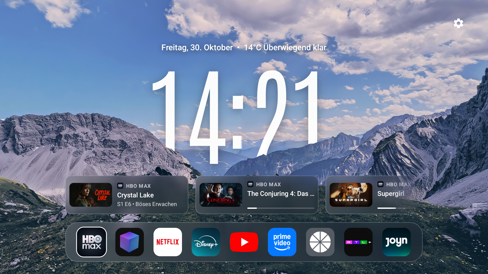
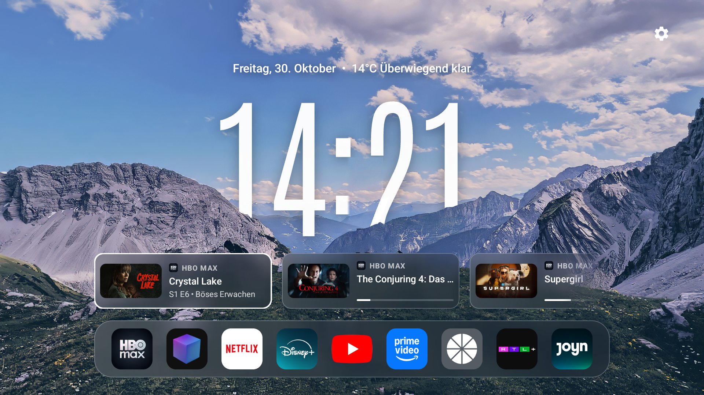
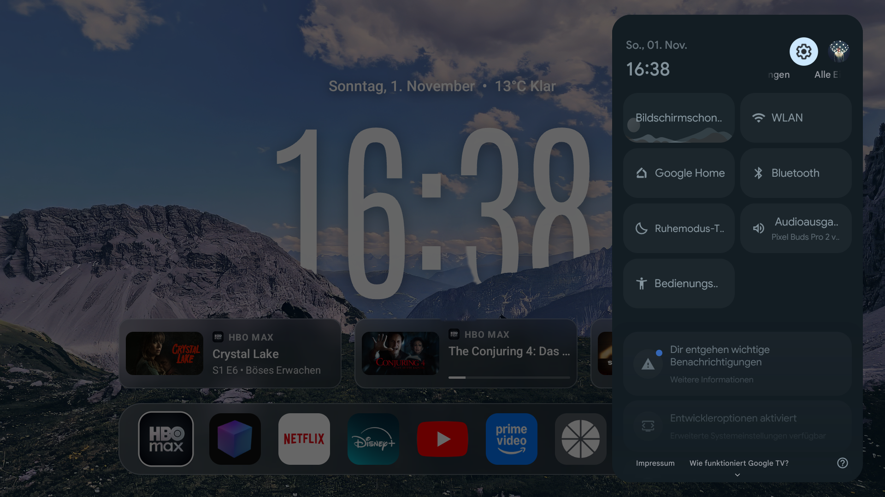
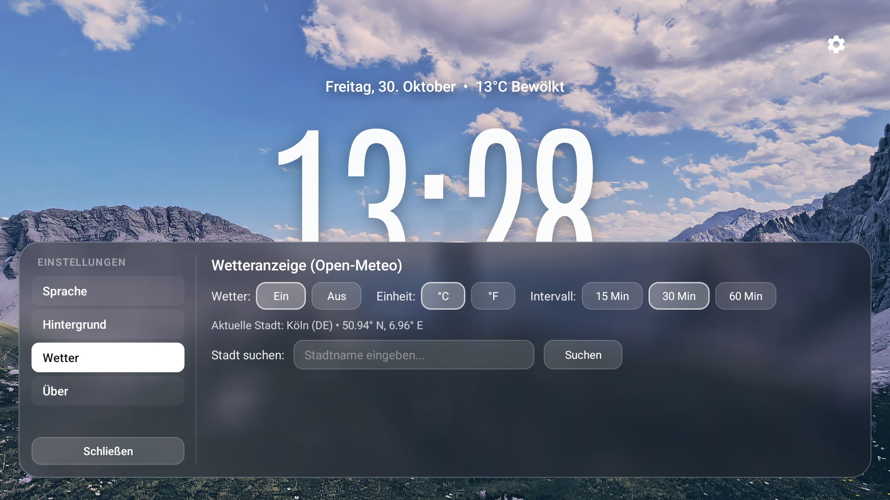
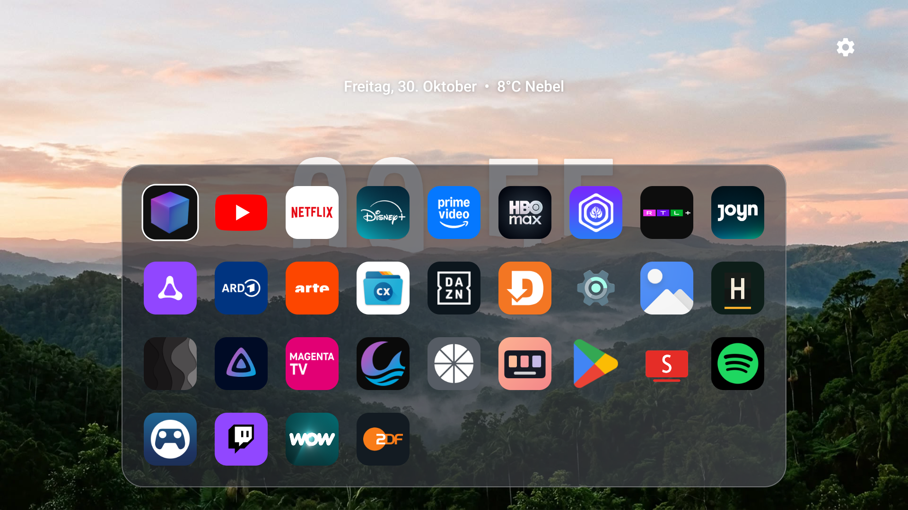

# ❄️ Frost TV Launcher

[](LICENSE)
[](https://android.com/tv/)
[-orange.svg)]()
[]()

Ein nativer, ultra-schlanker und flüssiger Android TV & Google TV Launcher im modernen **Milchglas-Design (Frosted Glass)** mit dreidimensionaler **Tiefeneffekt-Uhr (Depth Clock)**, dynamischer **Weiterschauen-Leiste (Keep Watching Shelf)** und **Live-Wetter**.

Entwickelt für maximale Performance (konstante 60 FPS), kompromisslose Privatsphäre (offline-first, 0% Telemetrie) und ein atemberaubendes Wohnzimmer-Erlebnis.

---

## 📸 Screenshots

| 01. Startbildschirm & Frosted Dock | 02. Weiterschauen (Keep Watching) |
|:---:|:---:|
| [](docs/screenshots/01_home_screen.png) | [](docs/screenshots/02_keep_watching_shelf.png) |
| *Tiefeneffekt-Uhr hinter Bergkamm, Live-Wetter und Frosted Dock* | *Fokussierte Sendungskarte mit Poster, Badge und Fortschrittsbalken* |

| 03. Google TV Schnelleinstellungen | 04. Launcher-Einstellungen |
|:---:|:---:|
| [](docs/screenshots/03_quick_settings_panel.png) | [](docs/screenshots/04_launcher_settings.png) |
| *Nahtlose Integration des Google TV Schnellzugriffs-Panels* | *Frosted Glasdialog für Hintergründe, Tiefeneffekt und Wetter* |

| 05. Alle Apps (App-Drawer) |
|:---:|
| [](docs/screenshots/05_app_drawer.png) |
| *6-spaltiges App-Grid im Frosted-Design für alle TV- und Sideload-Apps* |

---

## ✨ Features

- **⚡ 100% Nativ & 60 FPS:**
  - Komplett in nativem Java mit AndroidX und RecyclerView entwickelt.
  - Null WebViews, kein Chromium-Overhead, minimale Speichernutzung (< 40 MB RAM) – perfekt auch für TV-Hardware mit begrenzten Ressourcen.
- **💎 Milchglas-Ästhetik (Frosted Glass):**
  - Transluzente Glas-Container mit sanften Lichtkanten und adaptiver Weichzeichnung.
  - Feine, elegante Fokusumrandung (`1.5dp` reinweiß) mit geschmeidiger Feder-Skalierungsanimation (`1.08x`).
  - Minimalistische Icon-Only-Ansicht im Dock ohne störenden Text-Clutter.
- **🏔️ Dreidimensionale Tiefeneffekt-Uhr (Depth Clock):**
  - Übergroße Zeitanzeige in der Schriftart *Antonio Light*, die fotorealistisch hinter Bergkämmen, Dächern oder Horizonten eingebettet wird (Sandwich-Layering-Verfahren).
  - Vorinstallierte dynamische Naturszenen sowie volle Unterstützung für eigene Lieblingsbilder.
- **🎬 Dynamische „Weiterschauen“-Leiste (Keep Watching Shelf):**
  - Direkte Integration in den offiziellen Android TV Leanback `WatchNextProgram`-Provider (`content://android.media.tv/watch_next_program`).
  - Zeigt Vorschaubilder (Posters), Streamingdienst-Badges (z. B. Disney+, Netflix, Prime Video), Titel und den exakten Wiedergabefortschritt.
  - Perfekt bündig auf die Dockbreite abgestimmt; blendet sich automatisch ein und aus.
- **⛅ Live-Wetter & Datum:**
  - Datum auf Deutsch (`Donnerstag, 29. Oktober`) mit automatischem, akkuschonendem Wetterabruf im Hintergrund über die freie [Open-Meteo REST API](https://open-meteo.com/) (kein Tracking, kein API-Key erforderlich).
- **📱 6-Spaltiger App-Drawer:**
  - D-Pad nach unten auf dem Dock öffnet eine übersichtliche 6-spaltige Gesamtübersicht aller installierten Apps (sowohl Leanback TV-Apps als auch Sideloaded APKs).
- **🔒 Privatsphäre & Sicherheit:**
  - Keine Analyse-Tools, kein Google Analytics, kein Firebase, keine Werbenetzwerke, keine Telemetrie.

---

## 🎮 Fernbedienungs-Navigation (D-Pad)

| Taste | Kontext | Aktion |
|---|---|---|
| **D-Pad Links / Rechts** | Dock & Shelf | Wechselt horizontal zwischen Apps oder Weiterschauen-Karten |
| **D-Pad Oben** | Vom Dock | Wechselt zur Weiterschauen-Leiste (falls aktiv) oder zum Einstellungs-Zahnrad |
| **D-Pad Unten** | Vom Shelf | Wechselt zurück auf das Dock |
| **D-Pad Unten** | Vom Dock | Öffnet den vollflächigen **6-Spalten App-Drawer** (Alle Apps) |
| **D-Pad Center (OK)** | Überall | Startet die fokussierte App oder springt direkt zur gewählten Episode |
| **Zurück (Back)** | Drawer / Dialog | Schließt Menüs und setzt den Fokus wieder direkt auf das Hauptdock |

---

## 🎨 Eigene Hintergrundbilder & Tiefeneffekt einbinden

Eigene Wallpaper können direkt auf dem Fernseher hinterlegt werden:

1. Ordner auf dem TV anlegen:
   ```bash
   adb shell mkdir -p /sdcard/Wallpapers/
   ```
2. Hintergrundbilder übertragen:
   - `wallpaper.jpg`: Das Haupt-Hintergrundbild (1920x1080).
   - `wallpaper_fg.png` *(optional)*: Ein transparenter 32-Bit-PNG-Freisteller des Vordergrunds (z. B. Berge, Skyline), hinter dem die Uhr platziert wird.
   ```bash
   adb push mein_hintergrund.jpg /sdcard/Wallpapers/wallpaper.jpg
   adb push mein_freisteller.png /sdcard/Wallpapers/wallpaper_fg.png
   ```
3. Im Launcher oben rechts auf das **Zahnrad** klicken und **Hintergrundbild** anwählen – die eigenen Grafiken werden sofort geladen.

---

## 🛠️ Kompilieren & Bauen

### Voraussetzungen
- **JDK 17**
- **Android SDK Platform 34**
- **Android Build-Tools 34.0.0**

### Build-Befehle
```bash
# Repository klonen
git clone https://github.com/ved-io/frost-tv-launcher.git
cd frost-tv-launcher

# Debug-APK erstellen
./gradlew assembleDebug

# Release-APK erstellen
./gradlew assembleRelease
```
Die erstellte APK liegt anschließend unter:
`app/build/outputs/apk/release/app-release.apk`

---

## 🚀 Installation auf Android TV / Google TV

```bash
# 1. TV per ADB verbinden
adb connect <TV-IP-ADRESSE>:5555

# 2. APK installieren
adb install -r app/build/outputs/apk/release/app-release.apk

# 3. Berechtigung für TV-WatchNext-Einträge gewähren:
adb shell pm grant com.flankes.glasslauncher android.permission.READ_TV_LISTINGS

# 4. Als Standard-Launcher festlegen:
# Home-Taste auf der Fernbedienung drücken und "Frost TV Launcher" -> "Immer" wählen
```

---

## 🏛️ Architektur & Technologien

- **Sprache:** 100% Java
- **UI Toolkit:** AndroidX Leanback, RecyclerView, DynamicAnimation (`SpringAnimation`)
- **Grafik:** Hardware-beschleunigtes Custom Canvas Rendering, `FastBlur` Box-Filter & RS Fallbacks
- **APIs:** Android TV `TvContract.WatchNextPrograms`, Open-Meteo JSON API
- **Minimale SDK-Version:** Android 8.0 Oreo (API 26)
- **Ziel-SDK:** Android 14 (API 34)

---

## 📄 Lizenz

Dieses Projekt ist unter der [MIT License](LICENSE) lizenziert.
